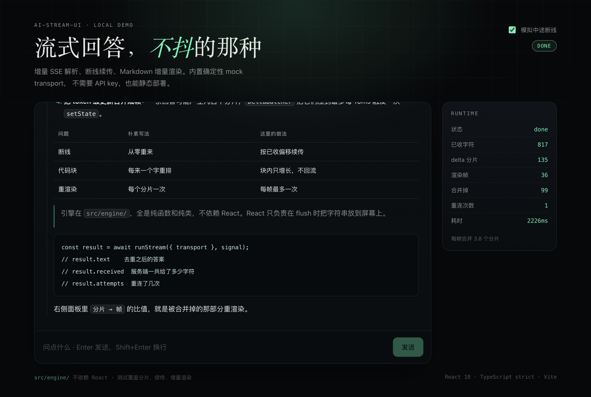

# ai-stream-ui

[](https://github.com/ma1833577561/ai-stream-ui/actions/workflows/ci.yml)
[](LICENSE)

**一个能扛住真实网络的流式对话前端。** 增量 SSE 解析、断线续传、Markdown 不抖动、token 级合帧，内置确定性 mock transport——克隆下来就能跑，不需要 API key。



> 右侧的 `runtime` 面板不是装饰：它是这四条断言的实时证据。`delta 分片 135 / 渲染帧 36 / 合并掉 99` 表示一次回答只触发了 36 次 `setState`。

## 它解决什么问题

流式对话的难点从来不是"把字显示出来"，而是下面四件事。每一件都在真实项目里以 bug 的形式出现过。

### 1. 分片边界落在任何地方

`data: 你好\n\n` 可能被拆成 `data: 你` + `好\n\n`，`\r\n` 可能被切成两半，UTF-8 字符也可能被切成两半。`chunk.split("\n\n")` 在这三种情况下都会丢字或错位。

`src/engine/sse.ts` 的 `SseParser` 保留缓冲区、只消费完整行，按 WHATWG 的 event-stream 规则逐字段处理（多行 `data:`、注释、`id`、`retry`、未知字段）。扫描游标 `scanFrom` 保证长行不会被反复重扫成 O(n²)。

### 2. 断线之后只能从头再来

一次回答 40 秒，第 30 秒网络抖一下，用户得到的是"重新生成"和前面白等的时间。

这里的约定是：传输层是 `(signal, from) => AsyncIterable<string>`，`from` 是**已收到的字符偏移**。重连时从偏移处继续，`runStream` 自带指数退避（默认 2 次、300ms 起）。如果服务端不支持偏移、整段重放，`mergeChunk` 会把与已收文本重叠的尾巴削掉，不会出现"你好你好"。

```ts
const result = await runStream({ transport }, signal);
// result.received  服务端一共给了多少字符
// result.attempts  重连了几次
// result.aborted   是用户主动停的，还是失败了
```

### 3. Markdown 一边流一边抖

`**加粗` 在闭合之前会让整段文字反复从粗变细；一个没闭合的表格头会先渲染成一排竖线，等分隔行到了再跳成表格。

`src/engine/markdown.ts` 做两件事：**只对未完成的最后一行做处理**，以及**给未闭合的 `**`、`` ` ``、`~~` 自动补上闭合符**——于是粗体从第一个字就是粗的，不会先显示星号再变粗。表格在分隔行到齐之前整体扣住不渲染，避免竖线闪一下。

为什么不干脆把最后一行藏起来？那样每行结束时会"啪"地跳一下，只是把抖动从字符级搬到了行级。

### 4. 每个 token 都触发一次 setState

一条长回答可能有几百个分片。每个分片都 `setState` 意味着几百次 React 渲染 + 几百次 Markdown 重解析。

`DeltaBatcher` 把它们按帧合并（默认 16ms）：分片进来先入缓冲，一帧最多铺一次。右侧 `runtime` 面板里"分片 → 帧"的比值就是被省掉的渲染次数。

## 快速开始

```bash
npm install
npm run dev          # http://localhost:5173
```

打开 `http://localhost:5173/?autoplay` 会自动跑一条完整回答，方便截图和演示。

```bash
npm run verify       # typecheck + 64 个单测 + 生产构建
npm run preview      # 预览构建产物
```

Node 18+。无后端、无环境变量、无网络请求。

## 接自己的后端

引擎不绑定 mock。换一个 transport 就行：

```ts
import { createFetchTransport } from "./src/transport/fetch";

const transport = createFetchTransport({
  url: "/api/chat",
  body: { messages },
  deltaEvent: "delta",
});
```

服务端契约：

- `POST /api/chat`，请求体 `{ ...body, from }`，`from` 是客户端已收到的字符数；
- 响应 `Content-Type: text/event-stream`，每个分片一个 `event: delta` + `data: <增量文本>`；
- 结束发一个 `event: done`，或直接关闭连接；
- 支持 `Last-Event-ID` 时可以忽略 body 里的 `from`，二选一。

`createFetchTransport` 用 `TextDecoder({ stream: true })` 解码，所以多字节字符被切在两次 read 之间也不会乱码。

## 模块

```
src/
  engine/            # 不依赖 React，可单测
    sse.ts           # 增量 SSE 解析（WHATWG 语义）
    stream.ts        # 重连 / 退避 / 去重 / 中止
    markdown.ts      # 分帧渲染：扣住半行、补全标记、扣住半张表
    scheduler.ts     # DeltaBatcher：按帧合并 setState
  transport/
    fetch.ts         # 真实后端（POST + SSE）
    mock.ts          # 确定性假模型：固定 seed、可注入断线
  ui/                # React 层：只负责把字符串放到屏幕上
```

引擎是纯函数和纯类，`tests/` 里 64 个用例全部打在引擎上——UI 层没有一行测试，因为它没有逻辑。

## 设计取舍

**不用 `EventSource`。** 它不能发 POST body、不能带认证 header、也不暴露原始字节流，无法测量和续传。代价是要自己解析 SSE，即 `sse.ts`。

**去重的重叠阈值是 8 个字符。** 服务端整段重放时，用"已收文本的结尾"和"新分片的开头"找最长重叠。阈值低于 8 时歧义太大（`ab` + `abundant` 到底重叠了几个字符？），干脆不猜、按新内容追加。真正的解法是服务端支持 `from` 偏移，重叠去重只是兜底。

**按帧而不是按 requestAnimationFrame 合帧。** rAF 在后台标签页会停，流也会跟着停；16ms 的定时器在隐藏时仍然工作，只是浏览器不绘制。定时器还便于在测试里注入假时钟。

**消息级 `memo`。** 每帧都会 `map` 一遍 turns，但只有正在流式输出的那条会拿到新对象，已完成的回答不会重渲染。

**没有状态管理库。** 一个 `useState` 数组 + 几个 ref 就够了；引入 reducer 反而会把"哪次 flush 更新了哪条消息"藏进 dispatch 里。

## 已知限制

- 续传依赖 transport 遵守 `from` 契约；不遵守时靠重叠去重兜底，但要求重叠至少 8 个字符。
- 标记补全只处理 `**`、`` ` ``、`~~`。单个 `*` 和 `_` 不补——`2 * 3` 里它是乘号，猜错比不猜更糟。
- 每条消息每帧重算一次 `renderable`，长回答是 O(n²)；十万字级别的回答需要改成增量累积。当前实现按"回答长度 ≤ 几千字"设计。
- 代码块的语法高亮没有做。要做的话应该挂在 `code` 组件的渲染上，而不是解析阶段。

## 测试

```bash
npm test
```

覆盖的是容易出事的地方，不是行数：

- SSE 在 24 种切点下都不丢事件、CRLF 跨块、裸 CR、多行 data、注释、`id`/`retry`、切成两半的 emoji；
- 断线后重连的偏移正好等于已收长度、退避序列 `[100, 200, 400]`、重试用尽、中止保留已收文本；
- Markdown 的围栏开合、半行扣留、标记补全、未完成表格扣留；
- 合帧：3 个分片压成 1 帧、突发只排 1 个定时器、`flushNow` 不双发、空帧不触发渲染。

`npm run verify` 把 typecheck、测试和构建串起来，CI 里跑的就是这一条。

## 部署

纯静态，`dist/` 丢到任何静态托管都行。GitHub Pages 用项目页需要带 base：

```bash
npm run build -- --base=/ai-stream-ui/
```

仓库里的 `.github/workflows/pages.yml` 会在 push 到 `main` 时自动构建并发布。

## License

[MIT](LICENSE) © 2026 马金栋
